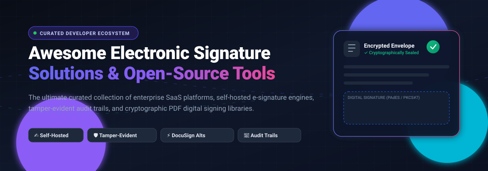

  

# ✍️ Awesome Electronic Signature Solutions

**A Curated Index of Legally Binding E-Signature Platforms, Self-Hosted Engines, Tamper-Evident Audit Trails & Cryptographic PDF Signing Libraries**

*Explore the top commercial SaaS platforms and open-source self-hostable alternatives to DocuSign, Adobe Sign, and HelloSign.*

---

## 📑 Table of Contents

- [🌐 Sector Overview & Market Dynamics](#-sector-overview--market-dynamics)
- [💼 SaaS & Enterprise Hosted Platforms](#-saas--enterprise-hosted-platforms)
- [🚀 Open-Source GitHub Projects & Self-Hosted Solutions](#-open-source-github-projects--self-hosted-solutions)
- [🧩 Key Comparison & Architectural Framework](#-key-comparison--architectural-framework)
- [🤝 How to Contribute](#-how-to-contribute)
- [☕ Support](#-support)
- [📈 Star History](#-star-history)
- [⚖️ Disclaimer & Compliance](#-disclaimer--compliance)

---

## 🌐 Sector Overview & Market Dynamics

The global electronic signature market is estimated between **$11 billion and $17 billion** (expanding at an aggressive ~23–37% CAGR toward $40B+ by 2030). The market is **moderately fragmented** with a distinct two-tier structure: general enterprise workflows are consolidated around high-cap incumbents (Adobe, DocuSign), while niche compliance (eIDAS QTSPs), API-first developer tools, and regional legal workflows remain widely fragmented across independent providers.

---

## 💼 SaaS & Enterprise Hosted Platforms

| 🏢 Product | 📊 Scale (Revenue / Valuation) | 💵 Pricing (Starting Tier) | 🎁 Free Tier / Trial Limits | 📝 Description |
|:---|:---|:---|:---|:---|
| **[Adobe Acrobat Sign](https://www.adobe.com/sign.html)** | **~$25.97B Rev / ~$95B Market Cap** (Adobe Inc.) | **$12.99/user/month** (Standard, annual) / **$19.99/user/month** (Pro, annual) | **7-day free trial** (Standard/Pro with full PDF and e-sign tools); **30-day trial** (Acrobat Sign Enterprise, capped at 200 transactions); Free Developer Sandbox with full REST API. | Enterprise document & e-signature solution bundled into Acrobat ecosystem. Per-license seat pricing with deep native PDF integrations. |
| **[DocuSign](https://www.docusign.com/)** | **~$3.36B Rev / ~$15B Market Cap** (NASDAQ: DOCU) | **$10/month** (Personal plan, billed annually) | **30-day free trial** (up to 5 recipients per envelope, up to 4 users; no credit card required); Free Developer Sandbox with full REST API. | Global benchmark for enterprise e-signatures and Intelligent Agreement Management with envelopes, templates, and certificate of completion. |
| **[Dropbox Sign](https://sign.dropbox.com/)** | **~$2.53B Rev / ~$7.5B Market Cap** (Dropbox Inc.) | **$15/user/month** (Essentials plan, billed annually) | **Free forever plan**: 3 signature requests per month; **30-day free trial** for paid plans; Developer test mode with sandbox. | E-signature platform (formerly HelloSign) offering unlimited signature requests on paid tiers and extensive language SDKs. |
| **[SignNow](https://www.signnow.com/)** | **~$1B+ Valuation** (airSlate parent unicorn) | **$8/user/month** (Business plan, billed annually) | **7-day free trial** (full access to Business Premium features); Developer trial available with **250 signature invites**; no permanent free sending tier. | Value-focused e-signature platform by airSlate with templates, role-based fields, and embedded signing workflows. |
| **[PandaDoc](https://www.pandadoc.com/)** | **~$100M+ ARR / ~$1B Valuation** | **$19/user/month** (Starter plan, billed annually) | **Free forever plan**: 5 document completions per month, 2 recipients per document, 5 templates; **14-day free trial** for paid plans. | Document automation and e-signature platform combining proposals, quotes (CPQ), and contract management. |
| **[OneSpan Sign](https://www.onespan.com/)** | **~$250M Rev / ~$850M Market Cap** (NASDAQ: OSPN) | **$22/user/month** (Professional plan, billed annually) | **30-day free trial** (full feature access, no credit card required; up to 1,000 transactions/user/year upon upgrade); Free Developer Sandbox. | Enterprise digital agreements focused on high-assurance security, cryptographic certificates, and rigorous banking audit trails. |
| **[BoldSign](https://boldsign.com/)** | **~$40M–$60M Rev** (Syncfusion parent company) | **$5/user/month** (Growth plan, billed annually) | **Free forever plan (Essential)**: 25 envelopes/month (business email) or 5 envelopes/month (personal email), 2 templates, 1 user; **30-day free trial** for paid plans (up to 50 envelopes, 10 users). | API-first and web e-signature platform by Syncfusion featuring automated initiation, robust webhook architecture, and dynamic field placement. |

---

## 🚀 Open-Source GitHub Projects & Self-Hosted Solutions

The table below lists top open-source electronic signature repositories, sorted by GitHub star count in descending order.

| 🛠️ Project | ⭐ Star Count | 📜 License & Stack | 💡 Highlights & Capabilities |
|:---|:---|:---|:---|
| **[DocuSeal](https://github.com/docusealco/docuseal)** |  | **AGPL-3.0** Ruby on Rails + PostgreSQL/SQLite | **The leading open-source DocuSign alternative with the most complete free edition.** WYSIWYG PDF form editor with **12 field types**, multiple signatories, and **tamper-evident audit certificate**. Features **AI-powered field detection** (v2.3.0+), unlimited envelopes on Community Edition, and lightweight single-container Docker setup. |
| **[Documenso](https://github.com/documenso/documenso)** |  | **MIT** TypeScript, Next.js, Prisma, PostgreSQL | **Modern, developer-centric e-signature platform with permissive licensing.** Core signing, templates, and full REST/tRPC API access. Supports **.p12 digital certificate signing** with verifiable cryptographic integrity in any PDF reader. Perfect for embedding into commercial SaaS applications. |
| **[signature_pad](https://github.com/szimek/signature_pad)** |  | **MIT** TypeScript / HTML5 Canvas | **The foundational JavaScript library for smooth signature drawing on HTML5 canvas.** Powers signature capture across thousands of web and mobile apps. Uses variable width Bézier curves for natural pen strokes and exports directly to PNG, SVG, or JPEG data URLs. |
| **[OpenSign](https://github.com/OpenSignLabs/OpenSign)** |  | **AGPL-3.0** Node.js, React, MongoDB | **Free and open-source DocuSign and PandaDoc alternative.** Features robust template workflows, parallel and sequential multi-signer routing, OpenSign Drive document management, IP-tracked audit trails, guest OTP verification, and REST APIs. |
| **[Digital Signature Service (DSS)](https://github.com/esig/dss)** |  | **LGPL-2.1** Java | **Official European Commission eIDAS digital signature framework.** Supports the creation, extension, and validation of advanced and qualified electronic signatures (PAdES, CAdES, XAdES, and ASiC). Essential for strict government and regulatory compliance. |
| **[node-signpdf](https://github.com/vbuch/node-signpdf)** |  | **MIT** Node.js / JavaScript | **Lightweight Node.js library for signing PDFs with digital signatures.** Injects byte-range cryptographic signatures into PDF buffers without external dependencies, supporting PKCS#7 signing certificates for automated server-side document sealing. |
| **[LibreSign](https://github.com/LibreSign/libresign)** |  | **AGPL-3.0** PHP, Vue.js (Nextcloud App) | **Native self-hosted digital signature app for Nextcloud.** Control document signing workflows on your private cloud. Integrates seamlessly into Nextcloud Files, supporting multiple signers, OTP validation, and cryptographic PDF timestamping. |
| **[DottedSign Self-Hosted](https://github.com/DottedSign-Official/dottedsign-self-hosted)** |  | **Proprietary / Community** Docker Compose | **Enterprise-grade self-hosted eSignature system for data sovereignty.** Deployable on-premises via Docker Compose to maintain total ownership of confidential contract flows, signers, and audit histories. |
| **[SignCraft](https://github.com/Steviewonders99/signcraft)** |  | **MIT** TypeScript / React | **Open-source AI contract review and e-signature platform.** Free alternative to DocuSign and PandaDoc. Draft, review, and sign legal agreements with integrated AI-powered clause analysis and risk detection. |
| **[Penpact](https://github.com/penpact/penpact)** |  | **AGPL-3.0** TypeScript / React / Node.js | **Developer-first open-source e-signature API for embedding signing in apps.** Features in-document signing with guided field flows, AI field detection (Claude/Gemini/GPT), append-only audit trails, and PAdES digital signatures on sealed PDFs. *(Early development v0.1.0)*. |

---

## 🧩 Key Comparison & Architectural Framework

* **Easiest Self-Hosted Deployment**: Choose **DocuSeal** if you want single-container Docker setup with SQLite, 512 MB RAM footprint, and an intuitive WYSIWYG form builder.
* **Best for Commercial SaaS Embedding**: Choose **Documenso** for its **MIT license**, modern TypeScript/Next.js stack, and cryptographic `.p12` digital certificate sealing.
* **Best for Complex Multi-Party Routing**: Choose **OpenSign** if your workflows require parallel/sequential multi-signer approval chains, templates, and integrated document management.
* **Best for Government & eIDAS Standards**: Choose **European Commission DSS** for strict PAdES/CAdES/XAdES qualified electronic signatures.
* **Best Lightweight Canvas Primitive**: Choose **signature_pad** for capturing smooth handwritten signatures in frontend web and mobile applications.

---

## 🤝 How to Contribute

Contributions are welcome and appreciated! To add a new platform or update existing entries:

1. 🍴 Fork the repository.
2. ✍️ Update `README.md` keeping entries factual, objective, and well-sourced.
3. 🏷️ Include: product/project name, official URL, star badge (for open source), and clear pricing/licensing details.
4. 🚀 Submit a Pull Request with a brief explanation.

---

## ☕ Support

If you found this curated list helpful, please consider giving it a star ⭐, sharing it with colleagues, or sponsoring the author!

* ⭐ **Star the repo:** Show your appreciation and help others discover this guide.
* 🍴 **Fork & Contribute:** Help keep pricing and open-source project developments up to date.
* 💖 **Sponsor & Buy a Coffee:** [Sponsor ishandutta2007 on GitHub Sponsors](https://github.com/sponsors/ishandutta2007)

---

## 📈 Star History

---

## ⚖️ Disclaimer & Compliance

- This is a **community-curated** list — not exhaustive and not legal advice.
- E-signature platforms handle legally binding agreements and signer PII; ensure compliance with ESIGN, UETA, eIDAS, and applicable data privacy regulations.
- Audit trails and digital certificate integrity are legally critical — test tamper-evidence and cryptographic validation before deploying any self-hosted system to production.

---

  Built with ❤️ for developers, legal ops teams, and privacy-conscious organizations.

